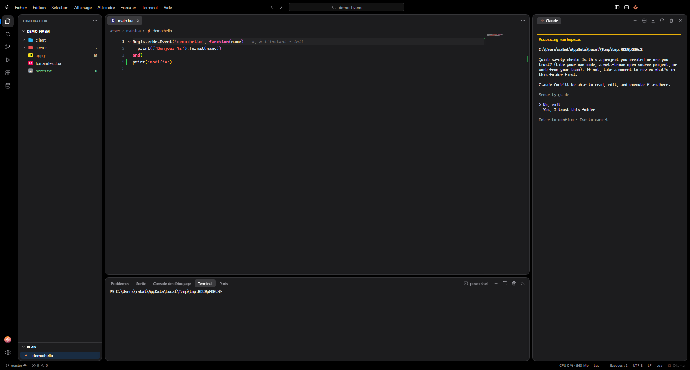
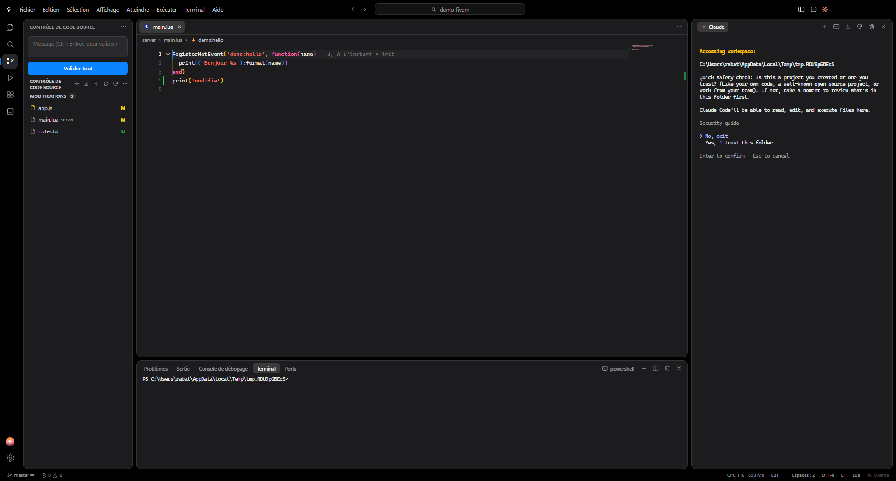
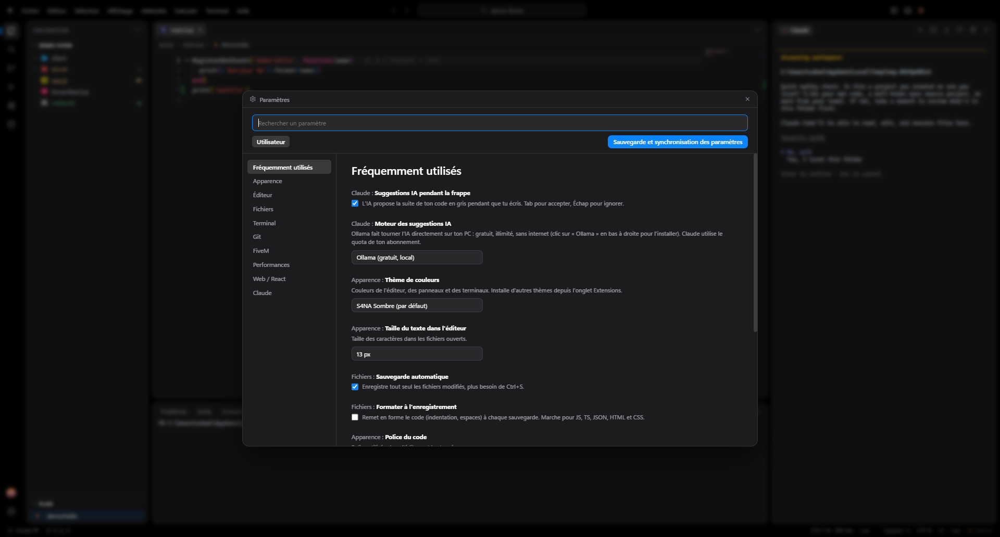

<p align="center">
  
</p>

<h1 align="center">S4NA Code</h1>

<p align="center">
  Éditeur de code pour Windows, clone de Visual Studio Code, construit en Rust avec Tauri v2.<br>
  Claude Code intégré, outils FiveM / Lua, SFTP, MySQL, Git, débogueur et Discord Rich Presence.
</p>

<p align="center">
  <a href="https://github.com/s4nare/s4na-code-releases/releases/latest"></a>
  
  
  
  
</p>

## Aperçu

<p align="center">
  
</p>

<table>
  <tr>
    <td width="50%"><br><sub>Contrôle de code source : changements, validation, synchronisation.</sub></td>
    <td width="50%"><br><sub>Paramètres : éditeur, terminal, IA, FiveM, Discord, mises à jour.</sub></td>
  </tr>
</table>

## Fonctionnalités

### Éditeur

- Moteur **Monaco** (celui de VS Code) : onglets, aperçu d'onglet, éditeurs côte à côte, minimap, sticky scroll, fil d'Ariane, plan du fichier.
- Multi-curseurs, sélection de toutes les occurrences, pliage de code, guides d'indentation, couleurs de parenthèses, rendu des espaces.
- Emmet, snippets utilisateur, formatage Prettier 3 (JS, TS, JSON, CSS, HTML, Markdown...) et StyLua (Lua).
- Enregistrement automatique avec délai, formatage à l'enregistrement, suppression des espaces de fin de ligne, saut de ligne final.
- Error Lens : erreurs et avertissements affichés en ligne.
- IntelliSense TypeScript / JavaScript, Lua (lua-language-server pour FiveM), CMake.
- Palette de commandes, ouverture rapide de fichiers, atteindre une ligne ou un symbole.
- Thèmes de couleurs, thème d'icônes Material, zoom de l'interface, position de la barre latérale et du panneau Claude.
- Profils, raccourcis personnalisables avec import des raccourcis VS Code.
- Récupération à chaud (hot exit) : fichiers non enregistrés et session restaurés au lancement.

### Explorateur et espace de travail

- Espace de travail multi-dossiers : plusieurs dossiers dans l'explorateur, en-tête repliable par dossier, ajout par Fichier > Ajouter un dossier à l'espace de travail ou clic droit, retrait par clic droit, dossiers retenus entre les sessions.
- Surveillance des fichiers sur tous les dossiers ouverts.
- Dossiers compactés, imbrication de fichiers (file nesting), révélation automatique du fichier actif.
- Création, renommage, déplacement, copier / couper / coller, copie du chemin absolu ou relatif.
- Glisser-déposer de fichiers et de dossiers depuis l'Explorateur Windows.
- Recherche dans les fichiers (regex avec lookahead, lookbehind et références arrière comme en JavaScript), remplacement global.
- Ouverture depuis l'Explorateur Windows (« Ouvrir avec S4NA Code »), instance unique.

### Git

- Panneau de contrôle de code source : changements, indexation, validation, annulation.
- Comparaison (diff) côte à côte, blame en ligne, historique.
- Branches, fetch, pull, push, synchronisation, intégration GitHub (`gh`).
- Indicateurs M / U / D dans l'explorateur et les onglets.

### Terminal et Claude

- Terminal intégré (xterm.js, pty natif) : PowerShell, CMD, Git Bash ; plusieurs terminaux, division, liens cliquables.
- **Terminal Claude Code intégré** dans un panneau dédié, avec onglets supplémentaires.
- Conversations Claude conservées : reprise automatique de la dernière conversation du dossier (nouvelle si aucune), réglage Paramètres > Au lancement de Claude.
- Ctrl+clic dans le terminal Claude : chemins `~\`, chemins avec espaces, chemins relatifs sur tous les dossiers ; ouverture de la comparaison Git si le fichier est modifié.
- Ajouter un fichier ou une sélection à Claude depuis le menu contextuel.
- Plugins Claude et pack de configuration.
- Tâches (npm, tsc, CMake...) avec détection des erreurs dans l'onglet Problèmes.
- Panneaux Problèmes, Sortie, Console de débogage, Ports.

### Débogage

- Débogueur Node.js : points d'arrêt, pas à pas, pile d'appels, variables, console.
- Aperçu intégré d'un site ou d'une application web (webview natif) avec retour arrière, rechargement et outils de développement.
- Gestionnaire de ports et de processus (CPU, mémoire).

### FiveM et Lua

- Lancement de **FXServer** dans S4NA avec sa console intégrée.
- RCON : envoi de commandes au serveur depuis l'éditeur.
- `ensure` automatique de la ressource à l'enregistrement, redémarrage au changement.
- Coloration et IntelliSense Lua, StyLua, `fxmanifest.lua` reconnu.
- Plan du fichier avec événements et commandes (`RegisterNetEvent`, `RegisterCommand`).

### SFTP et bases de données

- **SFTP** : navigation, édition directe, glisser-déposer avec progression.
- **MySQL / MariaDB** façon phpMyAdmin : navigation paginée, recherche, insertion, modification, import / export `.sql`, import des sessions HeidiSQL.
- Secrets de connexion chiffrés (DPAPI + AES-GCM).

### IA

- Complétion de code en ligne par **Ollama** (local, modèle au choix, par défaut `qwen2.5-coder:7b`) ou par **Claude**.
- Installation guidée d'Ollama depuis l'application.
- **WebCrack** : désobfuscation des bundles JavaScript en un clic droit (Node.js installé automatiquement au premier usage).

### Discord Rich Presence

Affiche sur ton profil Discord le fichier édité, le projet et le langage. Discord doit être ouvert sur le PC.

1. Créer une application sur [discord.com/developers](https://discord.com/developers/applications) nommée « S4NA Code ».
2. Copier son **Application ID**.
3. Dans S4NA Code : Paramètres > **ID d'application Discord**, coller l'ID.
4. Activer Paramètres > Statut Discord (Rich Presence).
5. Optionnel : ajouter une image `logo` dans Rich Presence > Art Assets.

### Mises à jour

- Détection au démarrage et via Aide > Vérifier les mises à jour.
- Dépôt de publication configurable (`s4nare/s4na-code-releases` par défaut), asset `S4NA-Code-Setup-*.exe`.
- Migration automatique depuis les versions Electron (0.1.x) : désinstallation de l'ancienne version, reprise des réglages, session et projets récents, raccourcis recréés, relance.

### Divers

- Live Share en réseau local.
- Gestionnaire de processus, métriques de l'application.
- Barre de titre personnalisée avec boutons de fenêtre natifs, glisser pour déplacer, double clic pour agrandir.

## Installation

Télécharger la dernière version : **[github.com/s4nare/s4na-code-releases](https://github.com/s4nare/s4na-code-releases/releases/latest)**

| Fichier | Usage |
|---|---|
| `S4NA-Code-Setup-x.y.z.exe` | Installateur NSIS : raccourcis Bureau et menu Démarrer, « Ouvrir avec S4NA Code », mises à jour automatiques |

Prérequis : Windows 10 ou 11 avec WebView2 (déjà présent sur les systèmes à jour). Installation silencieuse : `S4NA-Code-Setup-x.y.z.exe /S`.

Programme installé dans `%LOCALAPPDATA%\S4NA Code`, données utilisateur dans `%APPDATA%\s4na-code`.

## Compiler depuis les sources

Prérequis : Rust stable, Node.js 22+ (synchronisation de l'interface et installateur), Windows 10 / 11.

```bash
npm install
cd rust
build.bat
```

`build.bat` ouvre un menu ; chaque action est aussi appelable directement (`build.bat <action>`) :

| Action | Effet |
|---|---|
| `sync` | copie l'interface et les bibliothèques (Monaco, xterm, marked, DOMPurify, Emmet) dans `rust/ui/` |
| `check` | sync + `cargo check` |
| `dev` | sync + `cargo run` (debug, console visible) |
| `release` | sync + `cargo build --release` : `rust\target\release\s4na-code.exe` |
| `bundle` | sync + installateur NSIS dans `rust\target\release\bundle\nsis` |
| `publish` | construit et publie la release GitHub |
| `todo` | liste les canaux IPC pas encore portés |

Publier une version : changer `version` dans `rust/Cargo.toml` et `rust/tauri.conf.json` (identiques), puis `build.bat publish`. Détails dans [rust/README.md](rust/README.md).

## Architecture

Le processus principal est écrit en **Rust (Tauri v2)** ; l'interface est du HTML / CSS / JavaScript (Monaco, xterm.js) exécutée dans WebView2. `rust/bridge.js` recrée l'objet `window.api` et relaie chaque appel vers Rust par un canal IPC unique.

```
rust/
  bridge.js        recrée window.api, boutons de fenêtre, glisser-déposer
  src/main.rs      dispatcher IPC unique et cycle de vie
  src/app.rs       fenêtre, dialogues, actions d'application, instance unique
  src/core_fs.rs   fichiers, pty, recherche, surveillance, git / gh, extensions
  src/tools.rs     IA, Claude, Ollama, formatage, ports, FiveM, lua-ls, LSP
  src/extra.rs     fonctions annexes
  src/remote/      SFTP, MySQL, secrets
  src/native.rs    aperçu natif, chemins des fichiers glissés
  src/discord.rs   Discord Rich Presence
  src/migrate.rs   migration depuis Electron
```

| Fichier d'interface | Rôle |
|---|---|
| `index.html`, `style.css` | structure et styles |
| `renderer.js`, `workbench.js` | explorateur, onglets, menus, paramètres |
| `vscode-plus.js`, `editor-plus.js`, `language-servers.js` | fonctions d'éditeur, langages |
| `git-plus.js`, `debugger.js` | Git, débogueur |
| `power.js`, `extras.js`, `dev-kit.js` | tâches, raccourcis, profils, outils |
| `remote.js`, `webcrack.js` | SFTP / SQL, WebCrack |
| `claude-plugins.js`, `onboarding.js`, `icon-theme.js` | plugins Claude, accueil, icônes |

Contrat IPC : un canal = un bras `"nom-du-canal" =>` dans un module Rust, arguments positionnels, retour `ok(valeur)`, événements vers l'interface par `emit`.

Historique : jusqu'à la version 0.1.9, le processus principal reposait sur Electron (fichiers `main.js`, `preload.js`, `main-extra.js`, `remote-main.js`, conservés dans le dépôt). Depuis la 0.2.0, S4NA Code ne dépend plus d'Electron.

## Journal des versions

### 0.2.2
- Discord Rich Presence : fichier modifié, projet, langage et durée sur ton profil (Paramètres > Statut Discord).
- Correctif : les .bat / .cmd / .ps1 s'ouvrent de nouveau normalement (S4NA Code ne s'inscrit plus dans « Ouvrir avec » pour les scripts, nettoyage automatique).
- Correctif : la mise à jour depuis l'ancienne version Electron installée pour tous les utilisateurs la désinstalle bien.
- Liens du terminal Claude : les chemins entre parenthèses (Update(fichier.js)) sont cliquables.

### 0.2.1
- Espace de travail multi-dossiers, retenu entre les sessions, surveillance sur tous les dossiers.
- Conversations Claude conservées, réglage « Au lancement de Claude ».
- Ctrl+clic dans le terminal Claude (chemins `~\`, avec espaces, relatifs).
- Correctif : copier le chemin relatif et Ajouter à Claude calculent depuis le bon dossier.

### 0.2.0
- Portage du processus principal en Rust (Tauri v2), 101 canaux IPC, interface inchangée.
- Migration automatique depuis Electron : désinstallation, réglages, raccourcis, relance.
- Glisser-déposer depuis l'Explorateur, aperçu natif, Prettier 3, regex JavaScript, WebCrack embarqué.
- Correctif : un dossier pouvait s'afficher en double dans l'arbre.

### 0.1.1 à 0.1.9 (Electron)
- Itérations de stabilisation et d'ajouts successifs : terminal Claude, Git, débogueur, FiveM, SFTP / MySQL, WebCrack, profils, Live Share, mises à jour automatiques.

### 0.1.0
- Première version publique (Electron + Monaco).

## Raccourcis

| Action | Raccourci |
|---|---|
| Palette de commandes | `Ctrl+Shift+P` |
| Ouvrir un fichier | `Ctrl+O` |
| Aller au fichier | `Ctrl+P` |
| Enregistrer / Enregistrer sous | `Ctrl+S` / `Ctrl+Shift+S` |
| Nouvelle fenêtre | `Ctrl+Shift+N` |
| Rouvrir l'éditeur fermé | `Ctrl+Shift+T` |
| Fermer tous les éditeurs | `Ctrl+K W` |
| Rechercher / Remplacer | `Ctrl+F` / `Ctrl+H` |
| Rechercher / Remplacer dans les fichiers | `Ctrl+Shift+F` / `Ctrl+Shift+H` |
| Aller à la ligne | `Ctrl+G` |
| Sélectionner toutes les occurrences | `Ctrl+Shift+L` |
| Ajouter l'occurrence suivante | `Ctrl+D` |
| Plier le bloc | `Ctrl+Shift+[` |
| Afficher / masquer la barre latérale | `Ctrl+B` |
| Afficher / masquer le panneau | `Ctrl+J` |
| Diviser le terminal | `Ctrl+Shift+5` |
| Paramètres | `Ctrl+,` |
| Raccourcis clavier | `Ctrl+K Ctrl+S` |
| Zoom + / - / réinitialiser | `Ctrl++` / `Ctrl+-` / `Ctrl+0` |
| Valider (champ de message Git) | `Ctrl+Entrée` |

Tous les raccourcis sont modifiables et les raccourcis VS Code importables.
